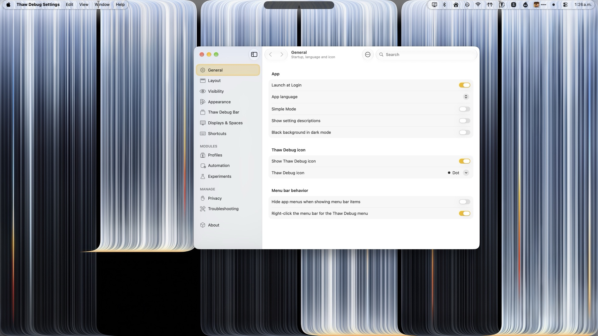

# Thaw

The open source menu bar manager for macOS. Hide the items you don't need, bring them back on demand, and find any of them in a keystroke. Free under GPL-3.0, with no tracking and no account. [Try it in your browser](https://www.getthaw.app/#try).

<p>
  <a href="https://discord.gg/KDfWjWDnR4"><picture><source media="(prefers-color-scheme: dark)" srcset="https://shieldcn.dev/badge/Discord-join.svg?variant=ghost&amp;size=xs&amp;mode=dark&amp;font=geist&amp;logo=discord&amp;" /></picture></a>
  <a href="https://www.bestpractices.dev/projects/13303"><picture><source media="(prefers-color-scheme: dark)" srcset="https://shieldcn.dev/github/openssf/thaw-app/Thaw.svg?variant=ghost&amp;size=xs&amp;mode=dark&amp;font=geist" /></picture></a>
  <a href="docs/VERIFYING_RELEASES.md"><picture><source media="(prefers-color-scheme: dark)" srcset="https://shieldcn.dev/badge/SLSA-Build_L3.svg?variant=ghost&amp;size=xs&amp;mode=dark&amp;font=geist&amp;logo=ri:GoPackage" /></picture></a>
  <a href="https://scorecard.dev/viewer/?uri=github.com/thaw-app/Thaw"><picture><source media="(prefers-color-scheme: dark)" srcset="https://shieldcn.dev/github/scorecard/thaw-app/Thaw.svg?variant=ghost&amp;size=xs&amp;mode=dark&amp;font=geist" /></picture></a>
</p>



## Install

```sh
brew install thaw        # macOS 15 to 26
brew install thaw@beta   # macOS 27
```

Or download the disk image from the [releases](https://github.com/thaw-app/Thaw/releases) and drag Thaw to Applications.

## Documentation

Visit https://www.getthaw.app/docs/thaw to view the documentation. [What Verified means](https://www.getthaw.app/verified) covers how releases are built and checked.

## Contributing

Please read the [contributing guide](https://github.com/thaw-app/.github/blob/main/.github/CONTRIBUTING.md). Pull requests go against the `development` branch. Translations go through [Crowdin](https://crowdin.com/project/thaw), and everyone who has helped is on the [community page](https://www.getthaw.app/community).

## License

Thaw is available under the [GPL-3.0 license](LICENSE). Linking with
PlatformRuntimeKit, the closed component that hides items, is allowed by an
[additional permission](LICENSE-EXCEPTION) under section 7.
