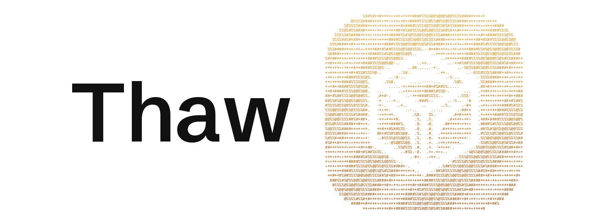
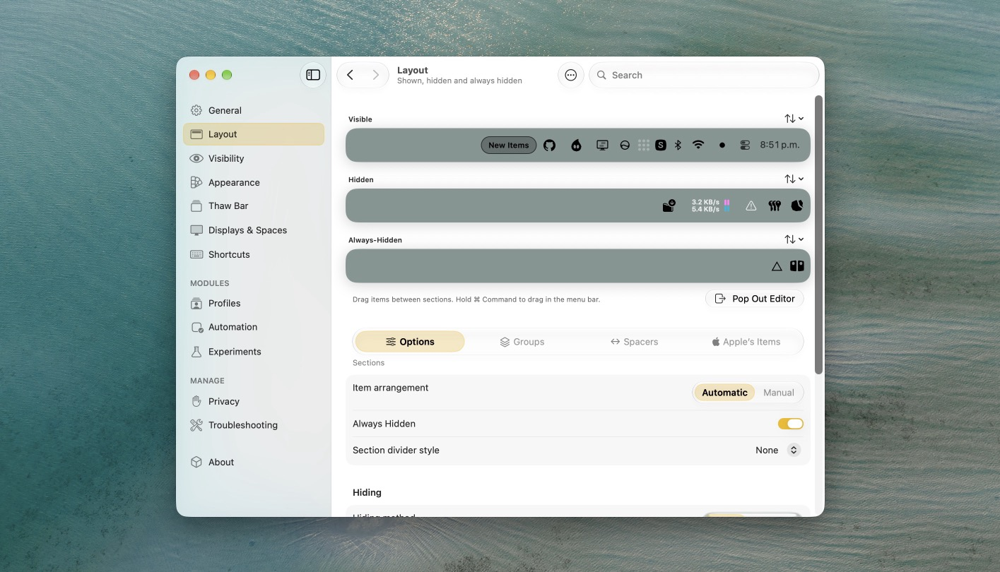

<p align="center">
  <a href="https://www.getthaw.app">
    <picture>
      <source media="(prefers-color-scheme: dark)" srcset=".github/assets/header-dark.gif">
      
    </picture>
  </a>
</p>

<p align="center">
  The open source menu bar manager for macOS.
</p>

<p align="center">
  <a href="https://www.getthaw.app/docs/thaw"><strong>Documentation</strong></a> ·
  <a href="https://www.getthaw.app/faq"><strong>FAQ</strong></a> ·
  <a href="https://www.getthaw.app/roadmap"><strong>Roadmap</strong></a> ·
  <a href="https://www.getthaw.app/community"><strong>Community</strong></a> ·
  <a href="https://www.getthaw.app/#try"><strong>Try it in your browser</strong></a>
</p>

<p align="center">
  <a href="https://discord.gg/KDfWjWDnR4"><picture><source media="(prefers-color-scheme: dark)" srcset="https://shieldcn.dev/badge/DISCORD-JOIN.svg?variant=ghost&amp;font=geist-mono&amp;logo=discord&amp;mode=dark" /></picture></a>
  <a href="https://scorecard.dev/viewer/?uri=github.com/thaw-app/Thaw"><picture><source media="(prefers-color-scheme: dark)" srcset="https://shieldcn.dev/github/scorecard/thaw-app/Thaw.svg?variant=ghost&amp;font=geist-mono&amp;label=SCORECARD&amp;mode=dark" /></picture></a>
  <a href="https://www.bestpractices.dev/projects/13303"><picture><source media="(prefers-color-scheme: dark)" srcset="https://shieldcn.dev/badge/OPENSSF-GOLD.svg?variant=ghost&amp;font=geist-mono&amp;logo=lu:ShieldCheck&amp;mode=dark&amp;valueColor=F0B429" /></picture></a>
  <a href="docs/VERIFYING_RELEASES.md"><picture><source media="(prefers-color-scheme: dark)" srcset="https://shieldcn.dev/badge/SLSA-BUILD_L3.svg?variant=ghost&amp;font=geist-mono&amp;logo=ri:GoPackage&amp;mode=dark" /></picture></a>
</p>

<p align="center">
  <a href="https://vercel.com/open-source-program"></a>
  <a href="https://www.producthunt.com/products/thaw-2"><picture><source media="(prefers-color-scheme: dark)" srcset="https://shieldcn.dev/badge/FEATURED_ON-PRODUCT_HUNT.svg?variant=ghost&amp;font=geist-mono&amp;logo=producthunt&amp;mode=dark" /></picture></a>
</p>

<picture>
  <source media="(prefers-color-scheme: dark)" srcset="docs/images/readme-hero-dark.jpeg">
  
</picture>

Thaw hides the menu bar items you don't need, brings them back on demand, and finds any of them in a keystroke. Free under GPL-3.0, with no tracking and no account.

## Install

<p>
  <picture><source media="(prefers-color-scheme: dark)" srcset="https://shieldcn.dev/group/badge/THAW_2-MACOS_15--26+badge/THAW_3-MACOS_27.svg?variant=ghost&amp;font=geist-mono&amp;mode=dark" /></picture>
</p>

```sh
brew install thaw
brew install thaw@beta
```

Or download the disk image from the [releases](https://github.com/thaw-app/Thaw/releases) and drag Thaw to Applications.

## Contributing

Please read the [contributing guide](https://github.com/thaw-app/.github/blob/main/.github/CONTRIBUTING.md). Pull requests go against the `development` branch. Translations go through [Crowdin](https://crowdin.com/project/thaw), and everyone who has helped is on the [community page](https://www.getthaw.app/community).

## License

Licensed under the [GPL-3.0 license](LICENSE), with an [additional permission](LICENSE-EXCEPTION) to link PlatformRuntimeKit.
